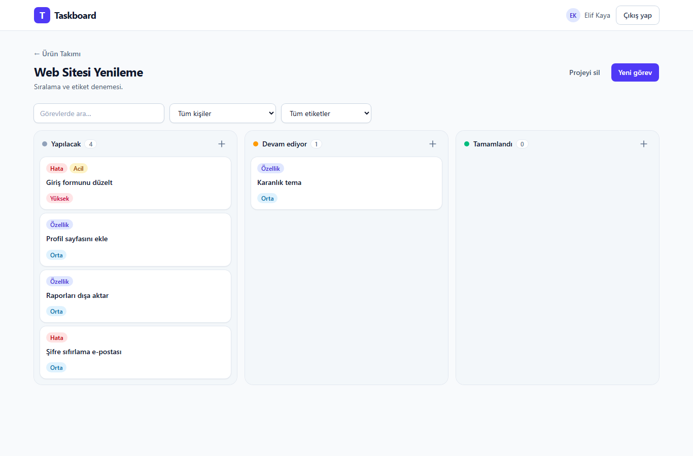
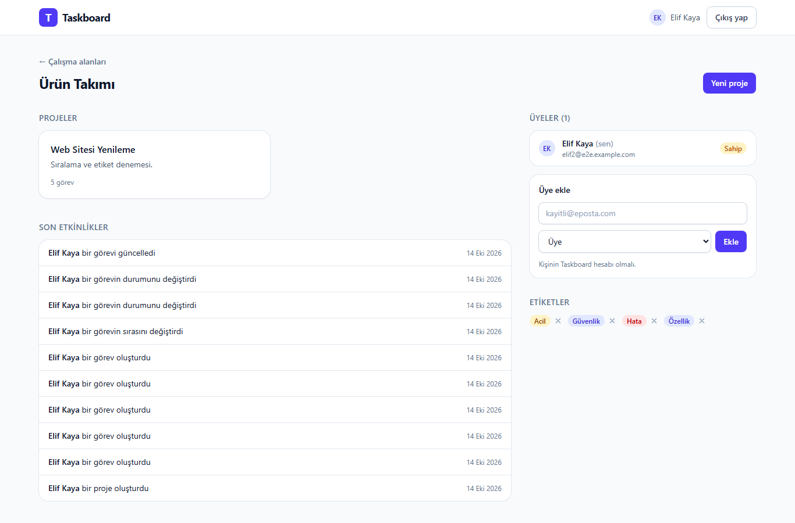
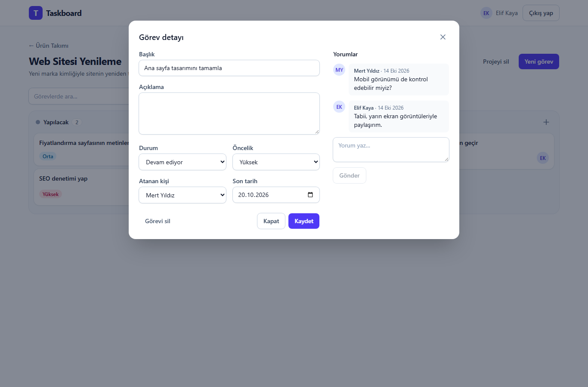
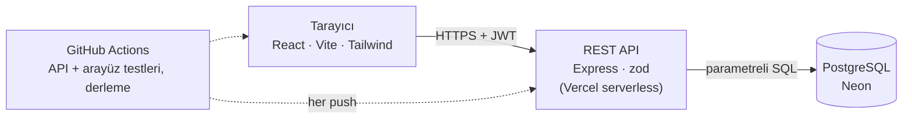
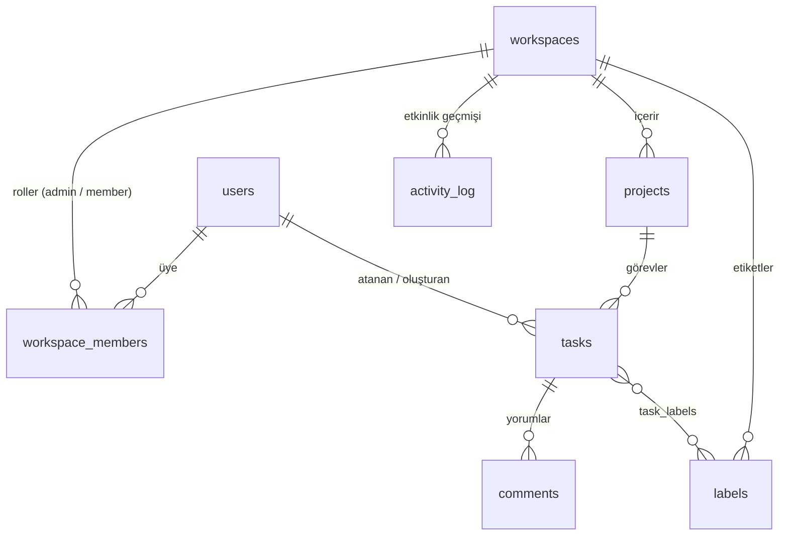

# Taskboard

Takımlar için görev ve proje yönetim uygulaması. Çalışma alanları, rollü üyelik, projeler, görevler ve yorumlar; REST API'si Node.js, Express ve PostgreSQL ile, arayüzü React ve Tailwind CSS ile yazıldı.




| Çalışma alanı | Görev detayı ve yorumlar |
| --- | --- |
|  |  |

**Canlı demo:** [taskboard-app-red.vercel.app](https://taskboard-app-red.vercel.app) · API: [taskboard-api-sand.vercel.app](https://taskboard-api-sand.vercel.app/health)

> **Durum:** API ve arayüz tamamlandı, Vercel üzerinde yayında. API testlerle doğrulandı.

## Özellikler

- E-posta ve şifre ile kayıt/giriş (JWT, bcrypt ile hash'lenmiş şifreler)
- Çalışma alanları: birden fazla takım, her biri kendi üyeleri ve projeleriyle
- Roller: **yönetici** (üye ve proje yönetimi) ve **üye** (görevlerle çalışır)
- Projeler ve görevler: durum (`todo`, `in_progress`, `done`), öncelik, atanan kişi, son tarih
- Görev listesinde durum/atanan filtresi, başlıkta arama ve sayfalama
- Görevlere yorum yazma ve çalışma alanı bazında renkli etiketler (görev başına birden fazla, etikete göre filtreleme)
- Çalışma alanı etkinlik geçmişi (kim, ne zaman, ne yaptı)
- Sürükle-bırak görev panosu: kartlar sütunlar arasında ve sütun içinde istenen sıraya taşınır; arayüz anında güncellenir, sunucu isteği reddederse eski haline döner, sıra veritabanında kalıcıdır
- Panoda başlığa ve atanan kişiye göre filtreleme; masaüstü ve mobilde çalışan duyarlı tasarım
- Klavyeyle gezilebilir kartlar ve diyaloglar (`Esc` ile kapanır), kullanıcı dostu hata mesajları

## Mimari



Arayüz ve API iki ayrı Vercel projesi olarak aynı depodan yayınlanır; veritabanı Neon üzerindedir.

### Veri modeli



## Tasarım kararları

- **Yetkilendirme sunucuda ve her uçta uygulanır.** Her istek, kullanıcının ilgili çalışma alanındaki üyeliğiyle birlikte tek sorguda çözülür. Üye olmayanlar için kaynak "yok" gibi davranır (403 yerine 404), böylece kimlik tahmin edilerek veri varlığı öğrenilemez.
- **Doğrulama tek yerde:** girdiler [zod](https://zod.dev) şemalarıyla kontrol edilir, hatalar tek biçimde döner. Güncelleme şemalarında varsayılan değer yoktur; gönderilmeyen alanlar sıfırlanmaz.
- **SQL enjeksiyonuna karşı** tüm sorgular parametrelidir. Dinamik `UPDATE` sütunları sabit bir izin listesinden gelir, `ILIKE` aramasında `%` ve `_` karakterleri kaçırılır.
- **Veri bütünlüğü** veritabanında da korunur: yabancı anahtarlar, `CHECK` kısıtları, sorgu desenlerine göre indeksler. Üye çıkarmak, görev atamalarını aynı işlem (transaction) içinde temizler.
- **Güvenlik katmanları:** `helmet`, CORS kısıtı, kimlik uçlarında hız sınırı, istek gövdesi boyut sınırı, giriş hatasında tek tip mesaj.
- **Test edilebilir yapı:** uygulama `createApp({ users, db })` ile bağımlılıklarını dışarıdan alır.

## API özeti

Kimlik gerektirmeyenler dışındaki tüm uçlar `Authorization: Bearer <token>` başlığı ister.

| Yöntem | Yol | Açıklama |
| --- | --- | --- |
| POST | `/api/auth/register` · `/api/auth/login` | Kayıt ve giriş, token döner |
| GET | `/api/auth/me` | Oturumdaki kullanıcı |
| POST · GET | `/api/workspaces` | Çalışma alanı oluştur / listele |
| GET | `/api/workspaces/:id` | Alan ve üyeleri |
| POST | `/api/workspaces/:id/members` | Üye ekle (yönetici) |
| PATCH · DELETE | `/api/workspaces/:id/members/:userId` | Rol değiştir / üyeyi çıkar (yönetici) |
| GET | `/api/workspaces/:id/activity` | Etkinlik geçmişi |
| POST · GET | `/api/workspaces/:id/projects` | Proje oluştur / listele |
| GET · PATCH · DELETE | `/api/projects/:id` | Proje detayı / güncelle / sil (yönetici) |
| POST · GET | `/api/projects/:id/tasks` | Görev oluştur / listele (`status`, `assigneeId`, `labelId`, `q`, `limit`, `offset`) |
| GET · PATCH · DELETE | `/api/tasks/:id` | Görev detayı / güncelle / sil (yönetici veya oluşturan) |
| POST | `/api/tasks/:id/move` | Görevi bir sütuna, belirli sıraya taşı (`status`, `index`) |
| POST · GET | `/api/tasks/:id/comments` | Yorum yaz / listele |
| POST · GET | `/api/workspaces/:id/labels` | Etiket oluştur / listele |
| DELETE | `/api/labels/:id` | Etiketi sil (yönetici) |

## Kurulum

Gereksinimler: Node.js 20+ ve bir PostgreSQL veritabanı ([Neon](https://neon.tech) ücretsiz planı yeterli).

```bash
git clone https://github.com/pietro379/taskboard.git
cd taskboard

# API
cd server
npm install
cp .env.example .env     # DATABASE_URL ve JWT_SECRET değerlerini doldurun
npm run migrate          # tabloları oluşturur
npm run dev              # http://localhost:3000

# Arayüz (ayrı bir terminalde)
cd client
npm install
npm run dev              # http://localhost:5173 (/api istekleri API'ye yönlendirilir)
```

Yayında arayüz ve API ayrı adreslerde çalışacaksa, arayüzü derlerken `VITE_API_URL` ile API adresini, API'de ise `CORS_ORIGIN` ile arayüz adresini verin.

## Testler

```bash
cd server && npm test    # API: kimlik doğrulama, yetki kuralları, etiketler, sıralama
cd client && npm test    # Arayüz: API istemcisi, giriş akışı, görev penceresi, taşıma mantığı
```

API testlerinden kimlik doğrulama olanları bellekte çalışır. Çalışma alanı, proje, görev, etiket ve sıralama testleri ise gerçek SQL'i ve yetki kurallarını geçici bir veritabanı şemasında dener; `DATABASE_URL` tanımlı değilse bu testler atlanır. Arayüz testleri Vitest, jsdom ve Testing Library ile yazıldı. GitHub Actions her push'ta PostgreSQL servisiyle API testlerini, arayüz testlerini ve arayüz derlemesini çalıştırır.

## Proje yapısı

```
.
├── .github/workflows/ci.yml   API testleri ve arayüz derlemesi
├── docs/                      README ekran görüntüleri
├── client/
│   └── src/
│       ├── api.js             Fetch sarmalayıcı, token ve hata yönetimi
│       ├── auth.jsx           Oturum bağlamı (giriş, kayıt, çıkış)
│       ├── components/        Ortak arayüz parçaları, görev diyaloğu
│       └── pages/             Giriş, çalışma alanları, çalışma alanı, pano
└── server/
    ├── migrations/            SQL şema dosyaları
    ├── src/
    │   ├── app.js             Express uygulaması (bağımlılıklar dışarıdan)
    │   ├── server.js          Giriş noktası
    │   ├── migrate.js         Migration çalıştırıcı
    │   ├── middleware/        Kimlik, yetki ve hata yönetimi
    │   ├── routes/            auth, workspaces, projects, tasks
    │   └── lib/               Transaction ve etkinlik kaydı yardımcıları
    └── tests/                 Vitest + Supertest
```

## Yol haritası

- [x] React arayüzü: giriş, çalışma alanları, sürükle-bırak görev panosu
- [x] Canlı yayın (API ve arayüz, Vercel)
- [x] Arayüz testleri
- [x] Görev etiketleri ve sütun içi sıralama
- [ ] Dosya ekleri
- [ ] E-posta ile üye daveti (harici e-posta servisi gerektirir)
